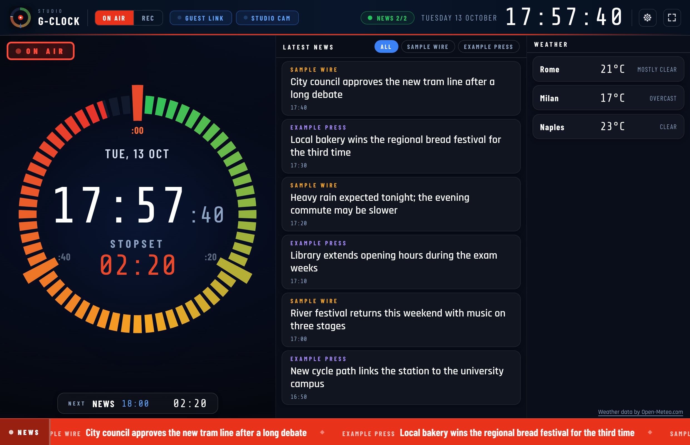
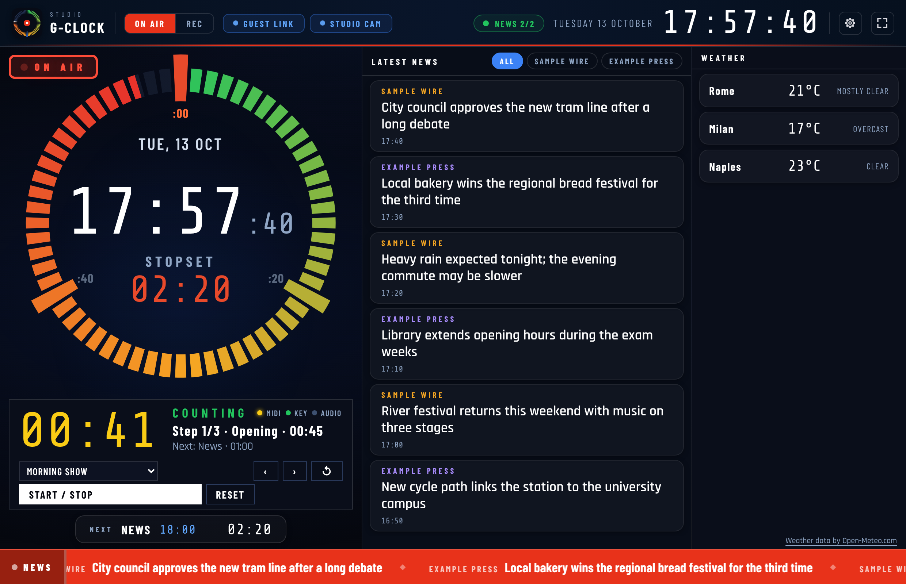
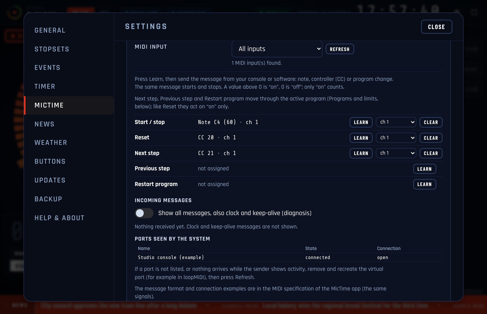
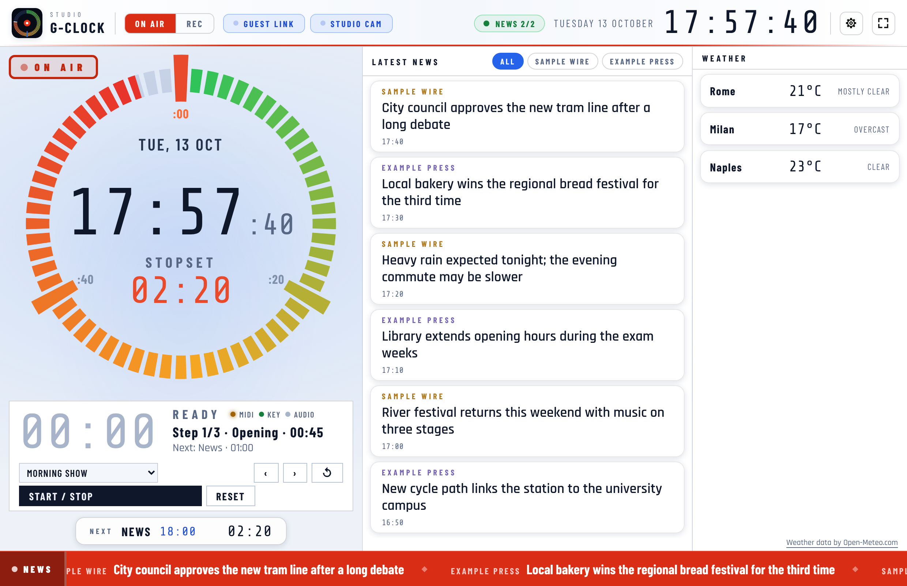

# G-Clock

Free desktop app (Windows / macOS / Linux): a **studio clock for radio presenters**. The classic 60-minute dial with stopset markers, news headlines from the feeds you choose, optional weather, an On Air / Rec switch, a recording timer with programs, blocks and a 3·2·1 pre-roll, and an optional **MicTime timer** (the same as the MicTime app) that times a speech from a MIDI message, a key or an audio level.

By Graziano Melzi · [OnAir Garage](https://onairgarage.com) — contact: hello@onairgarage.com



## Links

- Tool page: https://onairgarage.com/tools/g-clock/
- Author: Graziano Melzi · OnAir Garage · hello@onairgarage.com
- License: MIT (see `LICENSE`)
- MIDI specification of the MicTime timer (shared with the MicTime app): [MIDI-SPEC.md](https://github.com/djgragra/mictime/blob/main/docs/MIDI-SPEC.md)
- Systems: Windows, macOS (Intel and Apple silicon), Linux (AppImage, x64). **What has been run:** the unit tests and an end-to-end run of the real app (Electron under Xvfb) on Linux x64. The MicTime timer is the same code as the MicTime app, which the author tried on Windows (installer, MIDI from virtual ports, a global shortcut with another program in front, programs, colours) and on macOS Intel (MIDI from the IAC Driver). The author tried G-Clock 26.10.4 by hand on Windows and macOS (his declaration of 17 October 2026, no detail by function); 26.10.6 (ad-hoc signature, CSV report, clock only, blinking, Electron 44.9.3) has only had the automated run described above, and no real Linux desktop was used (see "Not validated").

## What it does

- **The studio dial**, on the left, as in Studio Clock: 60 minute segments that fill as the hour goes by (green, orange, red), the current minute filling second by second. In the centre, the time left to the end of the hour; in the last minutes it says END OF HOUR.
- **Stopsets** (ad breaks, news, jingles): you choose the minutes of the hour (for example `0, 30`). They are the larger markers on the dial, turn red when close and during their minute the centre shows the stopset name. The centre counts down to the next one. In the last seconds you choose (**blink when seconds left**, 60 by default, 0 = never) the countdown and the marker blink; with "reduce motion" in the system nothing blinks.
- **Stopset schedules by day and hour**: other sets of minutes for certain days and hours (for example `0, 20, 40` on weekday afternoons and `15, 45` at the weekend). The first schedule that fits the time of the clock applies, the default minutes apply outside them, and the dial redraws itself when a schedule starts or ends. A schedule can run past midnight (it belongs to the day it starts). Without schedules nothing changes.
- **Fixed events**: events at a time of day (news at 18:00, ad block at 18:20, a guest on air), each on the days you choose. Under the dial the clock shows the next one with a countdown, warns you **once** (the bar turns red at the number of seconds you choose for that event, 60 by default) and says NOW for ten seconds when it is time. Times follow the time zone of the clock; a change of summer time moves nothing (they are wall-clock times).
- **Headlines**, in the middle: the RSS / Atom feeds you add (https only), one tab per source, a page of six at a time turning every few seconds, plus a scrolling ticker at the bottom. Only title, source, time and link are shown; a click opens the article in your browser. The app reads the feeds itself, so there is no CORS problem and no server in between.
- **Weather** (optional, **off by default**), on the right: places found with Open-Meteo's geocoding; the Open-Meteo credit is always visible while it is on.
- **Date and time** large in the header, 24 or 12 hours, any time zone.
- **ON AIR / REC** switch (key `O`). **REC** replaces the dial with the recording timer:
  - **free time** with quick times, or a **program** made of blocks (opening, interview, closing…) each with its own time;
  - visual 3·2·1 pre-roll, pause and resume, overrun in red, optional beeps;
  - **end block**, redo and back; click a block to record out of order; several takes per block;
  - **dynamic timing**: what a block runs over or under is taken from, or given to, the next ones;
  - a **report** at the end of the program (copy it, save it as text or as **CSV** for a spreadsheet: one row per block, in seconds, and a TOTAL row);
  - programs are created and edited in the app, and can be imported and exported as JSON.
  Space starts and pauses, `N` ends the block, `R` resets.
- **Messages for the announcer** (Settings → Messages): up to nine saved short messages (120 characters each), shown large under the dial on the On Air screen. Keys `1`–`9` (or the buttons under the dial) show the saved message with that number, the same key again takes it off, `M` types a one-off message and `0`, or a click on it, clears it. The message on screen is not saved (after a restart the strip is empty); the saved ones are part of the settings and the backup. It stays visible in clock only. Everything is local: no network, no server.
- **Clock only** (Settings → General, or key `C` on the On Air screen): the dial alone, with no headlines, ticker, weather or feed status, for a wall screen. Feeds and cities stay configured and come back when you switch it off.
- **MicTime** (Settings → MicTime, **off by default**): the timer of the [MicTime](https://onairgarage.com/tools/mictime/) app, with the same options, inside G-Clock. The first signal starts the count, the next one stops it, the total stays on screen for a few seconds (or until the next start) and the timer returns to zero. It appears under the dial and, while recording, as a chip in the header (a click on it starts and stops).
  - **Signals**: a **MIDI message** (choose the input; start, stop, reset, next step, previous step and restart on a note, a controller or a program change, with **MIDI learn**, any channel or one, and a monitor of the incoming messages), a **key** you choose (global, working with another program in front where the system allows it, or with the window in front) and the **level of an audio input** (threshold and hold time; only the level is measured, nothing is recorded; off by default). One signal for start and stop, or two. The message format and connection examples are in the MicTime MIDI specification.
  - **Time limits and programs**: a program is a list of steps with a name and a limit (for example Opening 00:45, News 01:00, Interview 03:00); after every speech the next step is armed by itself; up to 8 programs of 40 steps; or a single time limit with no program. The figures are grey at zero, change to a warning colour before the limit (10 s by default), to red past it and blink slowly when it is passed by a lot; with "reduce motion" on in the system a steady red frame replaces the blinking. The four colours can be chosen.
  - While it is off nothing is listened to: no MIDI, no key, no microphone, and the system permissions are refused. Switching it on is a choice made here, not a side effect of anything else.
- **Theme** (Settings → General): dark (default), light or follow the system.
- **Your buttons**: buttons that open a web page in your browser (remote guest link, studio camera, station site…), each with a note that explains what it is for, plus ready-made ideas.
- **Your logo**: PNG, JPG or SVG, resized to 512 px at most and stored only on your computer.
- Always on top, full screen (`F` or `F11`), keep the screen awake.
- **Languages**: English (default), Italiano, Español — follows the system, can be changed in Settings.
- **Backup** (Settings → Backup): export or import the whole configuration (settings, programs, buttons, feeds, cities, events, schedules, the MicTime timer with its MIDI messages, keys, programs and colours) as `g-clock-backup-YYYY-MM-DD.json`. On import you choose between **replacing everything** and **adding only the missing items**. The file holds no passwords or keys: the app uses none. Files made by older versions still import.
- **Help & About** (Settings): version, system, licence, credits, links, **Copy support info** (version, system, language, last update check and last error; never your settings, addresses or file names) and **Open logs folder**. Daily log files, 5 MB at most each, 7 days kept.
- A small pill in the header says how many of your feeds answered; with no feed at all the headlines column shows a welcome with a button to add one.
- Made for a wide screen (16:9). On a tall window the dial goes on top and the headlines below.





The screenshots use made-up data (made-up feeds, a made-up MIDI device, a clock set by the script).

## Privacy and network

G-Clock only contacts:

- the news feeds **you** configured (https);
- `geocoding-api.open-meteo.com` and `api.open-meteo.com`, **only if you turn the weather on**;
- `api.github.com` / `github.com` to check for a new G-Clock release (can be turned off in Settings).

MicTime, once you switch it on, reads MIDI, keys and (if you enable it) the audio level **on this computer only**; the audio level needs the microphone permission of the system, and the audio is never recorded, saved or sent.

The window itself has no network access at all; everything remote goes through the main process, which accepts https addresses only. No accounts, no analytics, no telemetry.

## Install

Download the installer for your system from the [Releases](https://github.com/djgragra/g-clock/releases) page and check it against `SHA256SUMS.txt`.

The **user manual** is attached to every release as three PDFs: English (`G-Clock-Manual-EN-<version>.pdf`), Italian (`-IT-`) and Spanish (`-ES-`). Its source is in `docs/manual/` (`python3 docs/manual/build.py <version> <folder>` makes the PDFs; it needs Chrome or Chromium).

The app is free and has **no paid code-signing certificate**, so the first launch may show a warning:

- **macOS**: the app is signed ad hoc (no Apple account), so the first start says "unidentified developer": open *System Settings → Privacy & Security*, scroll down and click *Open Anyway*. **Second method**, in Terminal (it also opens an earlier version that says "damaged"):
  ```bash
  xattr -cr "/Applications/G-Clock.app" && codesign --force --deep -s - "/Applications/G-Clock.app"
  ```
- **Windows**: if SmartScreen appears, click *More info* → *Run anyway*.
- **Linux**: `chmod +x G-Clock-*.AppImage`, then run it.

### Updating

G-Clock looks for a new release once a day (Settings → Updates, can be switched off). A thin strip under the header says a new version is out and offers **Download and install**, **Remind me later** (24 hours), **Skip this version** and the release notes. The download shows a progress bar and a Cancel button, and the installer is checked against the SHA-256 in the release's `SHA256SUMS.txt`: a file that does not match, a cancelled or interrupted download leaves nothing behind (no `.part` file; one left by an earlier run, for example when the app was closed in the middle of a download, is removed at the next start). **Close and install** first makes a safety copy of your settings in the app's data folder (the last 3 are kept); on Windows it closes G-Clock and starts the installer, on macOS it opens the disk image, on Linux it shows the AppImage. The first start after an update shows **What's new**. Nothing is installed without a click, and the strip never covers the dial: it stays out of the way in full screen and while the recording timer runs.

## Rules the app follows, and their sources

| Value or rule | Source | Status |
|---|---|---|
| The dial: 60 segments, one per minute, minute 0 at 12 o'clock; colour from green at the start of the hour through orange to red at the end | the look of Studio Clock (the gradient stops are in `renderer/js/dialmath.js`) | by design; not a broadcast standard |
| Stopset minutes, schedules by day and hour (first that fits wins, may run past midnight), fixed events (wall-clock times, one warning) | this app | by design; tested in `dev/schedmath.test.mjs` |
| Program timer: blocks, takes, dynamic timing (what a block runs over or under is taken from, or given to, the next ones), report | this app | by design; tested in `dev/timermath.test.mjs` |
| MicTime timer: Note On velocity 0 = Note Off; value > 0 = on, 0 = off for notes and controllers; Program Change has no value | MIDI 1.0 channel messages (the velocity-0 convention is part of MIDI 1.0) and the convention of the MicTime timer, published in the MicTime `MIDI-SPEC.md` | recommended (the on/off rule is this app's convention, not part of MIDI) |
| MicTime timer: channels 1–16 shown, 0–15 on the wire; note 60 = C4 | MIDI 1.0, common naming | recommended; other devices name note 60 "C3" or "C5" |
| MicTime timer: audio level = RMS of a block of 1024 samples, in dBFS, silence = −100 dB | this app | not a standardised meter: it is a gate level, not a loudness or a true-peak reading |
| MicTime timer colours: *warning* from `limit − warning time`, *over* above the limit (strictly: a count of exactly the limit is still *warning*), *blink* above `limit + blink time` | this app | by design: not a rule of any broadcaster; the times are yours to set |
| Counting uses the computer's monotonic clock, shown in whole seconds, rounded down | this app | by design |
| Version comparison `YY.M.N`; the installer is checked against the SHA-256 of `SHA256SUMS.txt` | this app, GitHub release files | by design; tested with a fake GitHub |
| Connection examples for a Behringer X32 or MB Studio | none | **Dati insufficienti per verificare** (manufacturer manuals not read; see the MicTime app specification) |

## Assumptions and limits

- Not a certified instrument. A count starts and stops when the signal **arrives**; delays in a network, a driver or a virtual port are not compensated. The clock follows the computer's clock: it is not a time reference.
- Headlines depend on the publishers' feeds; free to read in a feed is not free to broadcast, and each publisher sets its own terms. The app ships with no feed other than three public examples you can remove.
- The global shortcut of the MicTime timer is handled by the operating system. It may be refused (another program uses it) or not work at all on some Linux desktops (for example Wayland). The app reports a refusal and keeps the window-only key.
- MIDI is read through the Web MIDI API of the Electron window. If the system has no MIDI driver the indicator says so. System-exclusive messages are not used (Electron asks for the "midiSysex" permission for every Web MIDI request, so the app allows it while the MicTime timer is on; no code reads such messages).
- The audio gate does not tell speech from noise: it follows the level only. While the MicTime timer is on, the system is not asked to stay awake: use *Keep the screen on* in General if the PC must not sleep.
- The light theme is the same layout with other colours; the dial colours (green to red) and the news source colours were chosen for the dark theme, and how they read on a studio screen at a distance, in light, is not judged.

## Validation and references

| Reference | What it validates | Result | How to re-run |
|---|---|---|---|
| Unit tests (`dev/*.test.mjs`) | settings validation, schedules and events, backup, guided update with a fake GitHub (hash mismatch, interrupted download, `.part` cleanup, safety copy), logs, support info, feed parsing, dial and timer arithmetic, the MicTime timer (MIDI parsing, learn, matching, toggle / separate / gate rules, keys, the audio gate, the stopwatch, limit colours, programs, settings and backup), the three languages, the report CSV, the ad-hoc signature wiring, the link of the update notice, blink and clock-only settings, packaging rules | 142 tests, all pass (Linux, Node 22) | `npm test` |
| End-to-end run of the MicTime timer (`dev/e2e-talk.mjs`) on the real app | off by default (nothing listened to, MIDI and microphone permissions refused), then on: the timer through the button, MIDI messages (injected into the real handler), learn, keys with the window in front, global shortcuts registered and released, programs (steps, loop, free, remembered step), limit colours, blinking and "reduce motion", chosen colours, clock only (key C and the setting), messages for the announcer (keys 1–9, M, 0, click, Esc, clock only), blinking of the countdown and the marker before a stopset (with 60, 0 and 120 s and with "reduce motion"), the audio gate with Chromium's fake audio device, the REC chip, the settings page, languages, dark / light / follow-the-system theme | all checks pass on **Linux x64, Electron under Xvfb** | `npm ci && node dev/e2e-talk.mjs` (needs `xvfb-run` or a display) |
| Screenshots (`dev/make-screenshots.mjs`) | the interface renders with fictitious data and the checks in the script pass | passes (Chromium, Linux) | `node dev/make-screenshots.mjs` |

## Not validated

- **By hand**: 26.10.4 was tried by the author on Windows and macOS (declaration of 17 October 2026; which functions exactly was not recorded). Not tried by hand: a real Linux desktop, and **26.10.6** on any system. In particular: the **ad-hoc signature** and whether the DMG opens on a clean Apple Silicon Mac (the build checks the signature on the Mac runner, nobody has opened the app); the **CSV report** in Excel, Numbers or LibreOffice and the save dialog (the file content is unit tested, the dialog was not opened); **clock only** on a real wall screen; the **messages for the announcer** on a real screen and with real keyboards (only the automated run was done); blinking with a real eye on a real screen.
- **Audio**: only Chromium's fake input device was used; no real microphone or sound card.
- **Real MIDI equipment**: MIDI arrived from virtual ports in MicTime app tests; a real console or controller was not used, and the input list on hot-plug is untested.
- **Updates**: *Close and install* (does the new version start again after the installer on Windows, `runAfterFinish`? the disk image on macOS) needs a second release to try.
- **Systems**: macOS Apple silicon, the AppImage on a real Linux desktop, the microphone permission prompt on macOS.
- **Global shortcuts**: tried on Windows only, in the MicTime app; not on macOS, Linux X11 or Wayland.
- G-Clock (with the MicTime timer on) and the MicTime app opened at the same time on the same MIDI input (a driver may give an input to one program only).
- The Spanish texts have not been read by a native speaker; the Italian ones have not yet been reread by the author for 26.10.4 and 26.10.6.

## Sources to re-check

| Document | Version read |
|---|---|
| MIDI 1.0 specification (MIDI Manufacturers Association) | not read |
| Behringer X32 / X32 Rack manual and MIDI implementation | not read |
| MB Studio manual | not found |
| Open-Meteo terms and API documentation | read when the weather was added; not re-read for this release |

## Run locally

Requires [Node.js](https://nodejs.org) 18+.

```bash
npm install
npm start
npm test        # unit tests: settings validation, schedules and events, backup, guided update, logs, feed parsing, dial and timer arithmetic, the MicTime timer, translations
node dev/e2e-talk.mjs   # end-to-end on the real app (Linux, xvfb-run or a display)
```

`dev/make-logo.mjs` draws `assets/logo.svg` and `dev/make-icons.mjs` generates every icon from it; `dev/make-screenshots.mjs` renders the interface with fictitious data for `docs/screenshots/`.

Build installers (output in `release/`):

```bash
npm run dist:win     # NSIS installer
npm run dist:mac     # dmg
npm run dist:linux   # AppImage
```

Releases are built by GitHub Actions: from the Actions tab run *Build installers* with the version (it must equal the one in `package.json` and be higher than the latest release), or push a `v*` tag.

## Structure

- `main.js`, `preload.cjs`: Electron main process (settings, feeds, weather, global shortcuts, permissions, updates, backup) and the bridge.
- `src/`: `schema.js` (settings), `talk.js` (settings of the MicTime timer), `backup.js`, `updater.js`, `feeds.js`, `weather.js`, `logs.js`, `support.js`, `store.js`, `i18n.js`, `limits.js` (limit colours and steps).
- `src/trigger/`: **the signal code of the MicTime timer, independent of Electron** (`midi.js`, `keys.js`, `level.js`, `stopwatch.js`), shared with the MicTime app (header `garage-common: trigger 2`).
- `renderer/`: the interface (`js/talk.js` draws the MicTime timer, `js/talk-signals.js` connects Web MIDI, keys and Web Audio to `src/trigger`, `js/talk-settings.js` is its settings page).
- `dev/`: tests, the end-to-end run, screenshot and icon generators. `docs/`: screenshots.

## Credits

- Electron (MIT), electron-store (MIT), fast-xml-parser (MIT).
- Fonts bundled locally: Barlow Condensed and Share Tech Mono, SIL Open Font License 1.1 (`renderer/fonts/OFL-*.txt`).
- Weather data: [Open-Meteo.com](https://open-meteo.com/), CC BY 4.0. Open-Meteo's free API is for non-commercial use.
- Each news publisher sets its own terms for its feed.

## Italiano

Orologio da studio per i conduttori radiofonici: il classico quadrante a 60 spicchi con gli stopset, titoli dai feed RSS che scegli tu, meteo facoltativo (spento di default), interruttore On Air / Rec e timer di registrazione con programmi a blocchi e pre-roll 3·2·1. Stopset diversi per giorno e fascia oraria, eventi fissi con conto alla rovescia (notiziario alle 18:00, pubblicità alle 18:20…), backup della configurazione, aggiornamento guidato con avviso sotto l’intestazione. **MicTime** (Impostazioni → MicTime, spento di default): lo stesso cronometro dell’app MicTime, dentro G-Clock, per cronometrare gli interventi con un messaggio MIDI, un tasto o il livello di un ingresso audio, con programmi di passi, tempi limite e colori. **Tema** scuro, chiaro o come il sistema. **Solo orologio** (tasto C): il quadrante da solo per uno schermo a parete. **Messaggi per lo speaker** (Impostazioni → Messaggi): fino a nove messaggi brevi salvati, mostrati in grande sotto il quadrante con i tasti 1–9 (M per uno scritto al volo, 0 per toglierlo). Lampeggio del conto alla rovescia e del segno prima di uno stopset, a N secondi a scelta. Report della registrazione anche in CSV. Pulsanti configurabili per aprire pagine web (ospite remoto, webcam di studio…), logo personalizzabile, impostazioni importabili/esportabili in JSON. Scarica l'installer dalla pagina [Releases](https://github.com/djgragra/g-clock/releases). Su macOS l'app è firmata ad-hoc (senza account Apple): al primo avvio dice «sviluppatore non identificato», si apre da Impostazioni di Sistema → Privacy e sicurezza → Apri comunque (o con il comando `xattr` sopra); su Windows SmartScreen → "Ulteriori informazioni" → "Esegui comunque". Quando esce una nuova versione, l'app la segnala con una striscia sotto l'intestazione: "Scarica e installa" scarica l'installer giusto, ne controlla lo SHA-256 e prima di installare salva una copia di sicurezza delle impostazioni; non si installa nulla senza di te.

## License

[MIT](LICENSE) © 2026 Graziano Melzi
